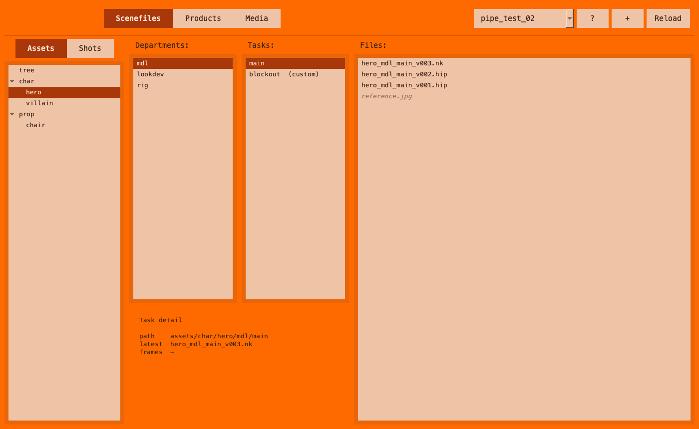

# Using Scheinwerk

The practical guide: how to install, run and use every part of Scheinwerk. The *why* and the exact rules live in [spec.md](spec.md). This file says *how*.

This guide grows with the code. A section that says *not yet available* describes something from a later phase (spec §16).

---

## Contents

1. [Install](#install)
2. [Development](#development)
3. [Concepts in five minutes](#concepts-in-five-minutes)
4. [Python API](#python-api)
5. [Workfile templates](#workfile-templates)
6. [Hooks](#hooks)
7. [CLI (`sw`)](#cli-sw)
8. [GUI](#gui)
9. [DCC integrations](#dcc-integrations)
10. [Sync (Synology Drive)](#sync-synology-drive)
11. [Troubleshooting](#troubleshooting)

---

## Install

You need [uv](https://docs.astral.sh/uv/getting-started/installation/). It fetches Python 3.11 by itself.

```bash
git clone https://github.com/BrokeLZ/Scheinwerk.git
cd Scheinwerk
uv sync                  # core + CLI + dev tools
uv sync --extra gui      # also installs PySide6 for the GUI
```

From inside the repo, run any command with `uv run`, for example `uv run sw --help`.

To have `sw` everywhere (in any project folder, in a DCC's shell), install it as a uv tool. `--editable` means it always runs the code in your checkout, so a `git pull` updates it:

```bash
uv tool install --editable /path/to/Scheinwerk
```

`uv tool uninstall scheinwerk` removes it again. If `sw` isn't found afterwards, run `uv tool update-shell` and open a new terminal.

## Development

| Task | Command |
| --- | --- |
| Install / update the environment | `uv sync` (add `--extra gui` for PySide6) |
| Run all tests | `uv run pytest` (the GUI tests in `tests/gui` only run after `uv sync --extra gui`; CI skips them) |
| Run core tests, stop at first failure | `uv run pytest tests/core -x` |
| Run one test | `uv run pytest tests/core/test_stdlib_only.py::test_core_imports_only_stdlib` |
| Lint | `uv run ruff check .` |
| Lint and auto-fix | `uv run ruff check . --fix` |
| Format | `uv run ruff format .` |
| CLI | `uv run sw --help` |

A change is done when `uv run pytest` and `uv run ruff check .` both pass.

**CI.** Every push and pull request runs lint, format check and tests on macOS and Windows with Python 3.11 (`.github/workflows/ci.yml`). Results are on the repo's *Actions* tab on GitHub.

**Python version.** The repo pins 3.11 in `.python-version`, because Houdini 21 runs Python 3.11. Don't use newer syntax or stdlib APIs.

**Repo layout.**

```text
src/scheinwerk/core/   stdlib-only pipeline logic
src/scheinwerk/cli.py  the `sw` command
src/scheinwerk/gui/    PySide6 browser (Phase 3)
src/scheinwerk/dcc/    DCC adapters (Phase 4+)
integrations/          files DCCs load at startup (Phase 4+)
tests/                 pytest, real throwaway projects in tmp_path
docs/                  spec.md (contract) and usage.md (this guide)
```

## Concepts in five minutes

- A **project** is any folder with a `scheinwerk.json` in it. Tools find the project by walking up from wherever you are, like git finds `.git`.
- **Entities** are what you work on: **assets** (`assets/[category/]hero`), **shots** (`shots/sq010/sq010_0010`) and **sequences** (`shots/sq010/_seq`).
- Each entity has **departments** (`mdl`, `lgt`, …) and each department has **tasks** (default `main`). Scene files live in `<dept>/<task>/work/`.
- **Workfiles** are named `{entity}_{dept}_{task}_v###.{ext}`, for example `sq010_0010_lgt_main_v012.hip`. One version counter per task, shared by all DCCs.
  - The name must match its folders exactly. `hero_mdl_main_v003_final.hip`, `villain_mdl_main_v003.hip` inside `hero/mdl/main/work/`, or `….HIP` in uppercase are **unmanaged**: still listed, but they don't count as versions. Rename them to the template to bring them back in.
  - Keep `work/` flat. Files in subfolders of `work/` are not workfiles.
- **Products** are versioned exports at entity level: `publish/<product>/v###/`. USD layers go to `publish/_usd/<layer>/v###/` and have a small **pointer layer** that points at the current version.
- **Media** (renders, playblasts) go to `media/<name>/v###/`.
- **Names** are lowercase `a-z`, `0-9` and `_`, never starting with `_`. Reserved words can't be used as names: `publish`, `media`, `work`, `cache`, `assets`, `shots`, `shared`, `io`, `entity`. Sequences are letters then digits (`sq010`). Shots are `<sequence>_####` (`sq010_0010`).
- **Custom departments** (not in the project template) work, but under an asset *without* a category, tools only recognise them once you're inside a task's `work/` or `cache/` folder. Assets in a category don't have this limit.
- **The path is the context.** Any file's location tells Scheinwerk which project, entity, department, task, product and version it belongs to. Nothing else is stored.

- **Assets vs. categories.** Every asset Scheinwerk creates gets an `entity.json`. A folder under `assets/` without `entity.json`, `publish/`, `media/` or a department is treated as a category. If you make asset folders by hand, add an `entity.json` containing `{"schema": 1}` (or a department folder) so they aren't mistaken for categories.
- **Version folders** count up from the highest existing `v###`, even an empty one, so a number is never reused. Empty versions are skipped when looking for "latest".
- **USD.** Publishing a layer updates its pointer (`publish/_usd/<layer>/<layer>.usd`) and the entity's entry/root layer (`publish/_usd/<entity>.usd`), which lists every layer strongest first: `usd_layer_order` from `scheinwerk.json`, then the rest A–Z.

Full layout: [spec §4](spec.md#4-on-disk-layout).

## Python API

The core is usable from any Python 3.11, including hython: everything `sw` does is one call here. It has no dependencies. Inside the repo use `uv run python`; elsewhere add `src/` to `PYTHONPATH`.

```python
from scheinwerk.core.project import Project
from scheinwerk.core.publish import finalize, ingest, next_publish, next_usd, set_current
from scheinwerk.core.context import Context

proj = Project.create("/path/to/myshow", "myshow")     # or Project.find(any_path_inside)

hero = proj.create_asset("hero", category="char")       # writes assets/char/hero/entity.json
shot = proj.create_shot("sq010_0010", frames=(1001, 1096))  # creates sq010 too
mdl = hero.create_department("mdl")                     # mdl/main/work + cache
task = mdl.task("main")

task.next_workfile("hip")        # …/work/hero_mdl_main_v001.hip  (path only, nothing created)
task.new_empty_workfile("hip")   # copies shared/templates/empty.hip there
task.new_version_from(task.latest_workfile())          # copy as next version

vdir = next_publish(hero, "pants_drape_base")           # creates publish/pants_drape_base/v001/
finalize(vdir, source=task.latest_workfile().path, comment="first drape")

vdir = next_usd(hero, "asset")   # publish/_usd/asset/v001/ — export the USD here, then:
finalize(vdir)                   # writes version.json, the pointer and hero.usd
set_current(vdir)                # roll the pointer back to this version later

ingest(["/Users/me/Downloads/scan.obj"], hero.create_product("scan"))  # copies, never moves

proj.entity("sq010_0010")        # look up by name; "asset:", "shot:", "seq:" if ambiguous
Context.from_path(vdir)          # what any path means: entity, dept, task, product, version…
```

All functions raise `scheinwerk.core.errors.ScheinwerkError` (or a subclass) with a message you can show as-is. Nothing in the core deletes, moves or overwrites your files. The full list of functions is in [spec §10](spec.md#10-core-api-scheinwerkcore).

## Workfile templates

"New empty workfile" copies `shared/templates/empty.<ext>` from the project. Scheinwerk can't make a valid empty `.hip` or `.blend` on its own, so save one from each DCC once:

| DCC | Save an empty scene as |
| --- | --- |
| Houdini | `shared/templates/empty.hip` (or `empty.hipnc`) |
| Nuke | `shared/templates/empty.nk` |
| Blender | `shared/templates/empty.blend` |

Without a template for an extension you get an error telling you which file to create.

## Hooks

Hooks are optional Python files that run after pipeline actions. Put them in `shared/hooks/` (per project) or in `hooks/` inside your user settings folder (`~/Library/Application Support/Scheinwerk/` on macOS, `%APPDATA%\Scheinwerk\` on Windows). Project hooks run first. Files starting with `_` are ignored.

Define any of these functions:

```python
# shared/hooks/notify.py
def post_create(kind, path, context):    # kind: asset, shot, sequence, dept, task, product
    ...

def post_publish(version_dir, context):  # after finalize
    ...

def post_save(path, context):            # after "Save next version" in a DCC (Phase 4+)
    ...
```

`path` and `version_dir` are `pathlib.Path`s; `context` is a `Context` (`context.entity`, `context.dept`, …). A hook that crashes is logged and skipped: it never blocks the action.

## CLI (`sw`)

`sw` works like git: run it anywhere inside a project and it finds `scheinwerk.json` by walking up. Path arguments are relative to where you are.

### Basics

- **Entities by name.** `hero`, `sq010`, `sq010_0010`: names are unique, so no paths are needed. If an asset and a sequence share a name, write `asset:sq010` or `seq:sq010` (also `shot:`).
- **`<dept>` or `<dept>/<task>`.** When a department has only one task you can leave the task out: `mdl` means `mdl/main`.
- **Output.** Commands that print paths print absolute paths. Add `--relative` for root-relative ones (`assets/char/hero/…`) or `--json` for JSON (`{"path": …}` or `{"paths": […]}`). `ls`, `frames`, `context`, `env` and `doctor` also have `--json`.
- **Errors** go to stderr as `sw: error: …`. Exit code 0 means success, 1 an error (also: `doctor` found issues, `latest` found nothing), 2 wrong usage.
- **Help.** `sw --help`, `sw <command> --help`, `sw new <what> --help`.

### Setting up a project

```bash
mkdir myshow && cd myshow
sw init                                       # project name = folder name (or: sw init myshow)
sw new asset char/hero                        # category/asset; plain `sw new asset hero` works too
sw new category vehicle                       # an empty category
sw new seq sq010
sw new shot sq010_0010 --frames 1001-1096     # makes sq010 if it doesn't exist
sw new dept hero mdl                          # tasks from the template (main)
sw new dept hero groom --tasks main alt       # or your own tasks
sw new task hero mdl blockout
sw new product hero pants                     # an empty product folder
sw frames sq010_0020 1097-1180                # set a range later; `sw frames sq010_0020` shows it
```

Each `new` prints what it created. Names must follow the [naming rules](#concepts-in-five-minutes); `sw` tells you what's wrong otherwise.

### Looking around

```console
$ sw ls
assets
  char/hero
shots
  sq010  1001-1180
    sq010_0010  1001-1096
    sq010_0020  1097-1180

$ sw ls hero
hero (asset in char)
departments
  mdl
    main
products
  asset  [usd]  latest v001, current v001
  scan  latest v001
media
  (none)

$ sw ls hero mdl            # tasks of a department
$ sw ls hero mdl/main       # workfiles, newest first, then anything unmanaged
```

Things that don't follow the rules are listed with `[invalid name]`; departments and tasks that aren't in the project template show `[custom]`.

`sw context [path]` shows what a path means to Scheinwerk (default: where you are):

```console
$ cd assets/char/hero/mdl/main/work && sw context
root         /Users/you/projects/myshow
entity_type  asset
entity       hero
category     char
sequence     -
dept         mdl
task         main
area         work
…
```

### Workfiles

```bash
sw next hero mdl --ext hip          # path of the next version: …/hero_mdl_main_v002.hip
sw latest hero --work mdl           # newest workfile of any DCC
sw ingest ~/Downloads/old.hip hero mdl     # copy files in as new versions, one version each
```

`sw next` creates nothing: paste the path into the DCC's *Save As*. The version counter is shared by all DCCs in a task.

### Publishing

```bash
V=$(sw next-usd hero asset)         # creates publish/_usd/asset/v00N/ and prints it
# … export the USD into $V (Houdini: USD ROP with "Use Relative Paths") …
sw finalize "$V" -m "first lookdev" --source "$(sw latest hero --work mdl)"

sw next-publish hero pants          # publish/pants/v00N/
sw next-media sq010_0010 render_beauty     # media/render_beauty/v00N/
sw latest hero --product pants      # newest version that has files (also --usd, --media)
sw set-current <usd version folder> # roll a USD layer's pointer back (or forward)
sw ingest scan.obj ref.jpg hero --product scan   # copies into one new version folder
```

`finalize` writes `version.json` (comment, source workfile, user, date). For USD versions it also updates the layer's pointer and the entity's entry/root layer. If a USD version has several `.usd` files and none is named `{entity}_{layer}_v###.usd`, add `--main <file>`. Finalizing again only changes what you pass, so `sw finalize <dir> -m "new comment"` edits the comment.

### Environment variables in a shell

```bash
eval "$(sw env --shell zsh)"        # zsh or bash: sets SW_ROOT, SW_ENTITY, SW_TASK_DIR, …
sw env --shell pwsh | Invoke-Expression   # PowerShell
```

Without `--shell` it prints `KEY=value` lines. See [spec §7.2](spec.md#72-environment-variables) for the variables.

### Health check

```console
$ sw doctor
empty version  /Users/you/projects/myshow/assets/char/hero/publish/pants/v001
1 issue
```

`sw doctor` never changes anything. It reports:

| Kind | Meaning | What to do |
| --- | --- | --- |
| `invalid name` | A folder breaks the naming rules. | Rename it by hand (lowercase, `a-z0-9_`). |
| `conflict copy` | Synology made a `…Conflict…` copy. | Compare with the original, keep one. |
| `absolute path` | A `.usd`/`.usda`/`.nk` contains a drive letter, `/Users/`, `/Volumes/` or `\\server` path (the first one is shown). | Re-export with relative paths (USD ROP: *Use Relative Paths*; Nuke: `[getenv SW_ROOT]/…`). `cache/` is not checked. |
| `empty version` | A version folder has no files (an export that failed or was cancelled). | Delete it or export into it. |

It exits with 1 when it finds anything, so it can run in scripts.

### All commands

| Command | Does |
| --- | --- |
| `sw init [name]` | Make the current folder a project. |
| `sw new asset\|category\|seq\|shot\|dept\|task\|product …` | Create things (see above). |
| `sw ls [entity] [dept[/task]]` | List. |
| `sw frames <entity> [START-END]` | Show or set a frame range. |
| `sw next <entity> <dept[/task]> --ext E` | Next workfile path. |
| `sw next-publish\|next-usd\|next-media <entity> <name>` | Create the next version folder. |
| `sw latest <entity> --product N\|--usd L\|--media N\|--work D[/T]` | Newest version/workfile. |
| `sw finalize <version_dir> [-m C] [--source P] [--main F]` | Write `version.json` (+ USD pointer). |
| `sw set-current <usd_version_dir> [--main F]` | Point a USD layer at a version. |
| `sw ingest <files…> <entity> <dept[/task]>` or `… --product N` / `--media N` | Copy files in. |
| `sw context [path]` | What a path means. |
| `sw env [path] [--shell zsh\|bash\|pwsh]` | `SW_*` variables. |
| `sw doctor` | Report problems. |
| `sw gui [path]` | Open the browser (see [GUI](#gui)). |

## GUI



### Starting it

The GUI needs PySide6, the `gui` extra: run `uv sync --extra gui` once in the repo. (A plain `uv sync` removes it again, so keep `--extra gui` from then on.)

```bash
sw gui                         # opens your most recent project
sw gui .                       # opens the project you're in, at the asset/shot/task you're in
uv run scheinwerk-gui          # the same, without the CLI
```

### Finding your way

- **Top bar.** *Scenefiles / Products / Media* switch the view. The dropdown holds your recent projects. `?` shows a cheat sheet, `+` makes a new project or adds an existing one, *Reload* (or F5) re-reads the disk. The browser also reloads by itself when its window gets focus.
- **Left column.** *Assets* (grouped by category) or *Shots* (grouped by sequence; `sq010 (sequence)` is the sequence-level work area `_seq`).
- **Scenefiles view.** Departments, tasks, then the task's workfiles, newest first. Files that don't follow the naming are shown *in italics* (unmanaged). A department with one task selects it for you.
- **Products / Media views.** Products (USD layers first), their versions (`(current)` marks the version the USD pointer uses, empty versions are in italics) and the files in a version. Image sequences show as one line: `name.####.exr  1001-1096 (96)`.
- **Detail panel** (under Departments/Tasks): path, latest version and frame range, or for a version: source, comment, date, user.
- **Filter.** Click into any column and just type; a filter field appears. Esc clears it.
- Each view remembers what you had selected, as long as the window is open.


### Doing things: right-click

There are no buttons for actions: everything is in the right-click menu of the column it concerns.

| Right-click on | You get |
| --- | --- |
| Assets / shots | New asset… (type `name` or `category/name`), New category…, or New sequence…, New shot…; Set frame range…; Copy path / relative path; Reveal |
| Departments | New department ▸ (from the template, or Custom…); Copy path; Reveal |
| Tasks | New task…; Copy path; Reveal |
| A workfile | Open, Open with ▸, New version from this, Copy path / relative path, Reveal |
| Anywhere in Files | New empty workfile ▸ (from `shared/templates/empty.<ext>`), **Copy next version path ▸**, Ingest file(s)… |
| Products / media | New product… / New media…, **Copy next version folder** (creates it), Ingest file(s)…, Copy path, Reveal |
| A version | Open folder, Finalize / Edit comment…, Set as current (USD), Copy path / relative path, Reveal |

Also:

- **Double-click** a workfile to open it, a version to reveal it in Finder/Explorer.
- **Drag files** from Finder/Explorer onto a task (or into its Files column) to ingest them as new workfile versions, or onto a product/media name to ingest them as its next version. Originals are copied, never moved.

The everyday loop with any DCC: right-click in Files → *Copy next version path ▸ .hip* → paste into the DCC's *Save As*. For exports: right-click the product → *Copy next version folder* → export there → right-click the new version → *Finalize*.

### Choosing which application opens what

*Open* uses your operating system's default app, unless you set one per extension in your settings file (`~/Library/Application Support/Scheinwerk/settings.json` on macOS, `%APPDATA%\Scheinwerk\settings.json` on Windows; created the first time you run the GUI):

```json
{
  "schema": 1,
  "dcc": {
    "hip":   { "name": "Houdini", "exe": "/Applications/Houdini/Houdini21.0.512/Houdini FX 21.0.512.app" },
    "nk":    { "name": "Nuke",    "exe": "C:\\Program Files\\Nuke16.0v1\\Nuke16.0.exe" },
    "blend": { "name": "Blender", "exe": "/Applications/Blender.app" }
  }
}
```

On macOS `exe` is the `.app`, on Windows the `.exe`. Every app listed here also appears under *Open with ▸*. The same file stores your recent projects and the window size; it never goes into a project.

### Changing the look

All colours, fonts and spacing are in `src/scheinwerk/gui/theme.qss` (Qt style sheets, like CSS). Edit it and restart the GUI.

## DCC integrations

*Not yet available.* Houdini arrives in Phase 4, Nuke in Phase 5, Blender in Phase 6.

Until then, any DCC works by hand: create folders and names following the conventions above, and save or export through the DCC's own dialog.

## Sync (Synology Drive)

- Exclude `cache/` folders from sync with a Synology Drive file filter. Caches are large and never referenced downstream.
- Scheinwerk writes pointer layers and `version.json` last and atomically, so the other machine never sees a pointer to a version that hasn't synced yet.
- Synology conflict copies (`…_Conflict…`) are not hidden. `sw doctor` reports them.

## Troubleshooting

| Problem | Fix |
| --- | --- |
| `uv: command not found` | Install uv (link above), then open a new terminal. |
| `sw: command not found` | Use `uv run sw` inside the repo, or install it as a tool (see [Install](#install)). |
| `sw: error: Not inside a Scheinwerk project` | `cd` into a project (any folder below its `scheinwerk.json`) or run `sw init`. |
| `sw: error: 'x' is ambiguous` | Prefix the name: `asset:x`, `shot:x` or `seq:x`. |
| `sw: error: The GUI needs PySide6` | `uv sync --extra gui` in the repo (and keep `--extra gui` on later syncs). |
| *Open* starts the wrong application | Set the app for that extension in `settings.json`, see [GUI](#choosing-which-application-opens-what). |
| Tests use the wrong Python | Run through `uv run`, which uses the repo's 3.11 environment. `uv sync` recreates it. |
