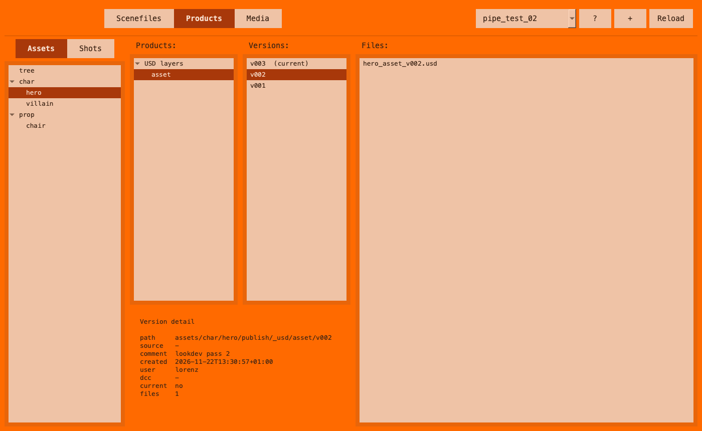

# Using Scheinwerk

The practical guide: how to install, run and use every part of Scheinwerk. The *why* and the exact rules live in [spec.md](spec.md). This file says *how*.

This guide grows with the code. A section that says *not yet available* describes something from a later phase (spec §16).

---

## Contents

1. [Install](#install)
2. [Development](#development)
3. [Concepts in five minutes](#concepts-in-five-minutes)
4. [Python API](#python-api)
5. [Workfile templates](#workfile-templates)
6. [Hooks](#hooks)
7. [CLI (`sw`)](#cli-sw)
8. [GUI](#gui)
9. [DCC integrations](#dcc-integrations) and [Houdini](#houdini)
10. [Sync (Synology Drive)](#sync-synology-drive)
11. [Troubleshooting](#troubleshooting)

---

## Install

You need [uv](https://docs.astral.sh/uv/getting-started/installation/). It fetches Python 3.11 by itself.

```bash
git clone https://github.com/BrokeLZ/Scheinwerk.git
cd Scheinwerk
uv sync                  # core + CLI + dev tools
uv sync --extra gui      # also installs PySide6 for the GUI
```

From inside the repo, run any command with `uv run`, for example `uv run sw --help`.

To have `sw` everywhere (in any project folder, in a DCC's shell), install it as a uv tool. `--editable` means it always runs the code in your checkout, so a `git pull` updates it:

```bash
uv tool install --editable /path/to/Scheinwerk
```

`uv tool uninstall scheinwerk` removes it again. If `sw` isn't found afterwards, run `uv tool update-shell` and open a new terminal.

## Development

| Task | Command |
| --- | --- |
| Install / update the environment | `uv sync` (add `--extra gui` for PySide6) |
| Run all tests | `uv run pytest` (the GUI tests in `tests/gui` only run after `uv sync --extra gui`; CI skips them) |
| Run the tests inside Houdini | `uv run pytest -m houdini` (needs Houdini installed; slow) |
| Run core tests, stop at first failure | `uv run pytest tests/core -x` |
| Run one test | `uv run pytest tests/core/test_stdlib_only.py::test_core_imports_only_stdlib` |
| Lint | `uv run ruff check .` |
| Lint and auto-fix | `uv run ruff check . --fix` |
| Format | `uv run ruff format .` |
| CLI | `uv run sw --help` |

A change is done when `uv run pytest` and `uv run ruff check .` both pass.

**CI.** Every push and pull request runs lint, format check and tests on macOS and Windows with Python 3.11 (`.github/workflows/ci.yml`). Results are on the repo's *Actions* tab on GitHub.

**Python version.** The repo pins 3.11 in `.python-version`, because Houdini 21 runs Python 3.11. Don't use newer syntax or stdlib APIs.

**Repo layout.**

```text
src/scheinwerk/core/   stdlib-only pipeline logic
src/scheinwerk/cli.py  the `sw` command
src/scheinwerk/gui/    PySide6 browser (Phase 3)
src/scheinwerk/dcc/    DCC adapters (Phase 4+)
integrations/          files DCCs load at startup (Phase 4+)
tests/                 pytest, real throwaway projects in tmp_path
docs/                  spec.md (contract) and usage.md (this guide)
```

## Concepts in five minutes

- A **project** is any folder with a `scheinwerk.json` in it. Tools find the project by walking up from wherever you are, like git finds `.git`.
- **Entities** are what you work on: **assets** (`assets/[category/]hero`), **shots** (`shots/sq010/sq010_0010`) and **sequences** (`shots/sq010/_seq`).
- Each entity has **departments** (`mdl`, `lgt`, …) and each department has **tasks** (default `main`). Scene files live in `<dept>/<task>/work/`.
- **Workfiles** are named `{entity}_{dept}_{task}_v###.{ext}`, for example `sq010_0010_lgt_main_v012.hip`. One version counter per task, shared by all DCCs.
  - The name must match its folders exactly. `hero_mdl_main_v003_final.hip`, `villain_mdl_main_v003.hip` inside `hero/mdl/main/work/`, or `….HIP` in uppercase are **unmanaged**: still listed, but they don't count as versions. Rename them to the template to bring them back in.
  - Keep `work/` flat. Files in subfolders of `work/` are not workfiles.
- **Products** are versioned exports at entity level: `publish/<product>/v###/`. USD layers go to `publish/_usd/<layer>/v###/` and have a small **pointer layer** that points at the current version.
- **Media** (renders, playblasts) go to `media/<name>/v###/`.
- **Names** are lowercase `a-z`, `0-9` and `_`, never starting with `_`. Reserved words can't be used as names: `publish`, `media`, `work`, `cache`, `assets`, `shots`, `shared`, `io`, `entity`. Sequences are letters then digits (`sq010`). Shots are `<sequence>_####` (`sq010_0010`).
- **Custom departments** (not in the project template) work, but under an asset *without* a category, tools only recognise them once you're inside a task's `work/` or `cache/` folder. Assets in a category don't have this limit.
- **The path is the context.** Any file's location tells Scheinwerk which project, entity, department, task, product and version it belongs to. Nothing else is stored.

- **Assets vs. categories.** Every asset Scheinwerk creates gets an `entity.json`. A folder under `assets/` without `entity.json`, `publish/`, `media/` or a department is treated as a category. If you make asset folders by hand, add an `entity.json` containing `{"schema": 1}` (or a department folder) so they aren't mistaken for categories.
- **Version folders** count up from the highest existing `v###`, even an empty one, so a number is never reused. Empty versions are skipped when looking for "latest".
- **USD.** Publishing a layer updates its pointer (`publish/_usd/<layer>/<layer>.usd`) and the entity's entry/root layer (`publish/_usd/<entity>.usd`):
  - An **asset**'s `hero.usd` is a *component*: one prim `/hero` whose payload `payload.usd` holds the asset's layers, `mtl` over `geo`. Referencing it loads nothing heavy until the payload is loaded.
  - A **shot**'s `sq010_0010.usd` lists its layers strongest first (`usd_layer_order` from `scheinwerk.json`, then the rest A–Z), then the sequence's root layer if it has one, else the project's **structure layer** `shared/usd/structure.usd` (`/world/chars`, `/world/props`, `/world/env`, `/world/fx`, `/world/cameras`, `/world/lights`, and `/Render` for render settings).
  - Every layer Scheinwerk writes carries the entity's fps, so USD doesn't retime 25 fps work.
  - A published layer may only point at other **published** files (never into `work/` or `cache/`): publish textures as a product (`publish/textures/v###/`) and sim data with *Scheinwerk Publish* before a USD layer uses them. `sw doctor` checks this.

  The full rules: [spec §9.2–9.3](spec.md#92-usd-layer).

Full layout: [spec §4](spec.md#4-on-disk-layout).

## Python API

The core is usable from any Python 3.11, including hython: everything `sw` does is one call here. It has no dependencies. Inside the repo use `uv run python`; elsewhere add `src/` to `PYTHONPATH`.

```python
from scheinwerk.core.project import Project
from scheinwerk.core.publish import finalize, ingest, next_publish, next_usd, set_current
from scheinwerk.core.context import Context

proj = Project.create("/path/to/myshow", "myshow")     # or Project.find(any_path_inside)

hero = proj.create_asset("hero", category="char")       # writes assets/char/hero/entity.json
shot = proj.create_shot("sq010_0010", frames=(1001, 1096))  # creates sq010 too
mdl = hero.create_department("mdl")                     # mdl/main/work + cache
task = mdl.task("main")

task.next_workfile("hip")        # …/work/hero_mdl_main_v001.hip  (path only, nothing created)
task.new_empty_workfile("hip")   # copies shared/templates/empty.hip there
task.new_version_from(task.latest_workfile())          # copy as next version

vdir = next_publish(hero, "pants_drape_base")           # creates publish/pants_drape_base/v001/
finalize(vdir, source=task.latest_workfile().path, comment="first drape")

vdir = next_usd(hero, "geo")     # publish/_usd/geo/v001/ — export the USD here, then:
finalize(vdir)                   # writes version.json, the pointer and hero.usd
set_current(vdir)                # roll the pointer back to this version later

ingest(["/Users/me/Downloads/scan.obj"], hero.create_product("scan"))  # copies, never moves

proj.entity("sq010_0010")        # look up by name; "asset:", "shot:", "seq:" if ambiguous
Context.from_path(vdir)          # what any path means: entity, dept, task, product, version…
```

All functions raise `scheinwerk.core.errors.ScheinwerkError` (or a subclass) with a message you can show as-is. Nothing in the core deletes, moves or overwrites your files. The full list of functions is in [spec §10](spec.md#10-core-api-scheinwerkcore).

## Workfile templates

"New empty workfile" copies `shared/templates/empty.<ext>` from the project. A new project (`sw init`, *New project…*) starts with Scheinwerk's defaults, copied from `src/scheinwerk/resources/templates/`:

| DCC | Template | Notes |
| --- | --- | --- |
| Houdini | `empty.hiplc` | an empty scene saved by Houdini 21 Indie |
| Nuke | `empty.nk` | a minimal script |
| Blender | `empty.blend` | not shipped yet: save an empty scene from Blender |

They are the project's own copies: replace one (save your own start scene over it, e.g. with your usual nodes or a 25 fps setup) or add more (`empty.hip`, `empty.hipnc`, …), and only that project changes. Creating a project never overwrites a template that is already there. A project made before this has none: copy the files from `src/scheinwerk/resources/templates/` into its `shared/templates/`. To change the defaults for future projects, change the files in `src/scheinwerk/resources/templates/`.

Without a template for an extension you get an error telling you which file to create.

## Hooks

Hooks are optional Python files that run after pipeline actions. Put them in `shared/hooks/` (per project) or in `hooks/` inside your user settings folder (`~/Library/Application Support/Scheinwerk/` on macOS, `%APPDATA%\Scheinwerk\` on Windows). Project hooks run first. Files starting with `_` are ignored.

Define any of these functions:

```python
# shared/hooks/notify.py
def post_create(kind, path, context):    # kind: asset, shot, sequence, dept, task, product
    ...

def post_publish(version_dir, context):  # after finalize
    ...

def post_save(path, context):            # after "Save next version" in a DCC (Phase 4+)
    ...
```

`path` and `version_dir` are `pathlib.Path`s; `context` is a `Context` (`context.entity`, `context.dept`, …). A hook that crashes is logged and skipped: it never blocks the action.

## CLI (`sw`)

`sw` works like git: run it anywhere inside a project and it finds `scheinwerk.json` by walking up. Path arguments are relative to where you are.

### Basics

- **Entities by name.** `hero`, `sq010`, `sq010_0010`: names are unique, so no paths are needed. If an asset and a sequence share a name, write `asset:sq010` or `seq:sq010` (also `shot:`).
- **`<dept>` or `<dept>/<task>`.** When a department has only one task you can leave the task out: `mdl` means `mdl/main`.
- **Output.** Commands that print paths print absolute paths. Add `--relative` for root-relative ones (`assets/char/hero/…`) or `--json` for JSON (`{"path": …}` or `{"paths": […]}`). `ls`, `frames`, `context`, `env` and `doctor` also have `--json`.
- **Errors** go to stderr as `sw: error: …`. Exit code 0 means success, 1 an error (also: `doctor` found issues, `latest` found nothing), 2 wrong usage.
- **Help.** `sw --help`, `sw <command> --help`, `sw new <what> --help`.

### Setting up a project

```bash
mkdir myshow && cd myshow
sw init                                       # project name = folder name (or: sw init myshow)
sw new asset char/hero                        # category/asset; plain `sw new asset hero` works too
sw new category vehicle                       # an empty category
sw new seq sq010
sw new shot sq010_0010 --frames 1001-1096     # makes sq010 if it doesn't exist
sw new dept hero mdl                          # tasks from the template (main)
sw new dept hero groom --tasks main alt       # or your own tasks
sw new task hero mdl blockout
sw new product hero pants                     # an empty product folder
sw frames sq010_0020 1097-1180                # set a range later; `sw frames sq010_0020` shows it
```

Each `new` prints what it created. Names must follow the [naming rules](#concepts-in-five-minutes); `sw` tells you what's wrong otherwise.

### Looking around

```console
$ sw ls
assets
  char/hero
shots
  sq010  1001-1180
    sq010_0010  1001-1096
    sq010_0020  1097-1180

$ sw ls hero
hero (asset in char)
departments
  mdl
    main
products
  geo  [usd]  latest v001, current v001
  scan  latest v001
media
  (none)

$ sw ls hero mdl            # tasks of a department
$ sw ls hero mdl/main       # workfiles, newest first, then anything unmanaged
```

Things that don't follow the rules are listed with `[invalid name]`; departments and tasks that aren't in the project template show `[custom]`.

`sw context [path]` shows what a path means to Scheinwerk (default: where you are):

```console
$ cd assets/char/hero/mdl/main/work && sw context
root         /Users/you/projects/myshow
entity_type  asset
entity       hero
category     char
sequence     -
dept         mdl
task         main
area         work
…
```

### Workfiles

```bash
sw next hero mdl                    # path of the next version: …/hero_mdl_main_v002 (add --ext hip for the extension)
sw latest hero --work mdl           # newest workfile of any DCC
sw ingest ~/Downloads/old.hip hero mdl     # copy files in as new versions, one version each
```

`sw next` creates nothing: paste the path into the DCC's *Save As*. The version counter is shared by all DCCs in a task.

### Publishing

```bash
V=$(sw next-usd hero geo)           # creates publish/_usd/geo/v00N/ and prints it
# … export the USD into $V (Houdini: USD ROP with "Use Relative Paths") …
sw finalize "$V" -m "first model" --source "$(sw latest hero --work mdl)"

sw next-publish hero pants          # publish/pants/v00N/
sw next-publish hero pants --file   # …/pants/v00N/hero_pants_v00N (folder created; add the extension in the DCC)
sw latest hero --product pants      # newest version that has files (also --usd, --media)
sw set-current <usd version folder> # roll a USD layer's pointer back (or forward)
sw ingest scan.obj ref.jpg hero --product scan   # copies into one new version folder
```

`finalize` writes `version.json` (comment, source workfile, user, date). For USD versions it also updates the layer's pointer and the entity's entry/root layer. If a USD version has several `.usd` files and none is named `{entity}_{layer}_v###.usd`, add `--main <file>`. Finalizing again only changes what you pass, so `sw finalize <dir> -m "new comment"` edits the comment.

### Environment variables in a shell

```bash
eval "$(sw env --shell zsh)"        # zsh or bash: sets SW_ROOT, SW_ENTITY, SW_TASK_DIR, …
sw env --shell pwsh | Invoke-Expression   # PowerShell
```

Without `--shell` it prints `KEY=value` lines. See [spec §7.2](spec.md#72-environment-variables) for the variables.

### Health check

```console
$ sw doctor
empty version  /Users/you/projects/myshow/assets/char/hero/publish/pants/v001
1 issue
```

`sw doctor` never changes anything. It reports:

| Kind | Meaning | What to do |
| --- | --- | --- |
| `invalid name` | A folder breaks the naming rules. | Rename it by hand (lowercase, `a-z0-9_`). |
| `conflict copy` | Synology made a `…Conflict…` copy. | Compare with the original, keep one. |
| `absolute path` | A `.usd`/`.usda`/`.nk` contains a drive letter, `/Users/`, `/Volumes/` or `\\server` path (the first one is shown). | Re-export with relative paths (USD ROP: *Use Relative Paths*; Nuke: `[getenv SW_ROOT]/…`). `cache/` is not checked. |
| `empty version` | A version folder has no files (an export that failed or was cancelled). | Delete it or export into it. |
| `unpublished reference` | A published `.usd`/`.usda` points into a task's `work/` or `cache/` folder (the first path is shown). Those change and `cache/` isn't synced. | Publish the file first (textures as a product, sims with *Scheinwerk Publish*), point the layer there and publish it again. |

It exits with 1 when it finds anything, so it can run in scripts.

### All commands

| Command | Does |
| --- | --- |
| `sw init [name]` | Make the current folder a project. |
| `sw new asset\|category\|seq\|shot\|dept\|task\|product …` | Create things (see above). |
| `sw ls [entity] [dept[/task]]` | List. |
| `sw frames <entity> [START-END]` | Show or set a frame range. |
| `sw next <entity> <dept[/task]> [--ext E]` | Next workfile path. |
| `sw next-publish\|next-usd\|next-media <entity> <name> [--file]` | Create the next version folder; with `--file` print the file path in it (no extension). |
| `sw latest <entity> --product N\|--usd L\|--media N\|--work D[/T]` | Newest version/workfile. |
| `sw finalize <version_dir> [-m C] [--source P] [--main F]` | Write `version.json` (+ USD pointer). |
| `sw set-current <usd_version_dir> [--main F]` | Point a USD layer at a version. |
| `sw ingest <files…> <entity> <dept[/task]>` or `… --product N` / `--media N` | Copy files in. |
| `sw context [path]` | What a path means. |
| `sw env [path] [--shell zsh\|bash\|pwsh]` | `SW_*` variables. |
| `sw doctor` | Report problems. |
| `sw gui [path]` | Open the browser (see [GUI](#gui)). |

## GUI


### Starting it

The GUI needs PySide6, the `gui` extra: run `uv sync --extra gui` once in the repo. (A plain `uv sync` removes it again, so keep `--extra gui` from then on.)

```bash
sw gui                         # opens your most recent project
sw gui .                       # opens the project you're in, at the asset/shot/task you're in
uv run scheinwerk-gui          # the same, without the CLI
```

### Finding your way

- **Top bar.** *Scenefiles / Products / Media* switch the view. The project dropdown lists your recent projects; at the bottom are *Open existing project…* (choose the project folder or any folder inside it) and *New project…*. *Reload* (or F5) re-reads the disk; the browser also reloads by itself when its window gets focus.
- **New project…** asks where the project folder goes (*Location*, with *Browse…*), its *Name*, *Frame rate*, *Resolution* and *Start frame*. The dialog shows the folder it will create, `<location>/<name>`. Frame rate and resolution have the common values in their dropdowns, or type your own (`23.976`, `2048x858`). Department templates, the USD layer order and ignore patterns stay in the project's `scheinwerk.json`; edit that file if you want different ones.
- **Left column.** *Assets* (grouped by category) or *Shots* (grouped by sequence; `sq010 (sequence)` is the sequence-level work area `_seq`).
- **Scenefiles view.** Departments, tasks, then the task's workfiles, newest first. Files that don't follow the naming are shown *in italics* (unmanaged). Something is always selected: picking an asset or shot selects its first department, first task and newest workfile (or what you had picked there before).
- **Products / Media views.** Products (USD layers first), their versions (`(current)` marks the version the USD pointer uses, empty versions are in italics) and the files in a version. Image sequences show as one line: `name.####.exr  1001-1096 (96)`.
- **Detail panel** (under Departments/Tasks): path, latest version and frame range, or for a version: source, comment, date, user.
- **Filter.** Click into any column and just type; a filter field appears. Esc clears it.
- Each view remembers what you had selected, as long as the window is open.



### Doing things: right-click

There are no buttons for actions: everything is in the right-click menu of the column it concerns.

| Right-click on | You get |
| --- | --- |
| Assets / shots | New asset…, New category…, or New sequence…, New shot…; Set frame range…; Copy path / relative path; Reveal |
| Departments | New department… (pick one of the template's or type your own; *Create task "main"* is on by default, untick it for a department without tasks); Copy path; Reveal |
| Tasks | New task…; Copy path; Reveal |
| A workfile | Open, Open with ▸, New version from this, Copy path / relative path, Reveal |
| Anywhere in Files | *Save scene as …* (browser panel inside a DCC only), New empty workfile ▸ (from `shared/templates/empty.<ext>`), **Copy next version path**, Ingest file(s)… |
| Products / media | New product… / New media…, Ingest file(s)…, Copy path, Reveal |
| Anywhere in Versions | **Copy next version path** (creates the new version folder) |
| A version | Open folder, Finalize / Edit comment…, Set as current (USD), Copy path / relative path, Reveal |

Creating assets, sequences and shots:

- **New asset** asks for a *Category* and a *Name*. The category dropdown always has `char`, `prop` and `env` plus any other categories in the project; you can also type a new one, or leave it empty for an asset without category. Right-clicking a category or an asset in it presets that category.
- **New sequence**: `+` and `-` count the name up and down in steps of 10 (`sq010` → `sq020` → `sq030`, and back). On an empty field the first click fills in the next free name. Or just type one.
- **New shot** has a *Sequence* and a *Shot* number, each with `-`/`+` that count in steps of 10. On an empty *Shot* field, `+` starts at the next free number in the chosen sequence. Right-clicking a sequence folder or one of its shots and choosing *New shot…* presets that sequence. The shot becomes `sq020_0040`; a sequence that doesn't exist yet is created with it. *Frames* is optional.

Also:

- **Double-click** a workfile to open it, a version to reveal it in Finder/Explorer.
- **Drag files** from Finder/Explorer onto a task (or into its Files column) to ingest them as new workfile versions, or onto a product/media name to ingest them as its next version. Originals are copied, never moved.

The everyday loop with any DCC: right-click in Files → *Copy next version path* → paste into the DCC's *Save As*. For exports: select the product, right-click in **Versions** → *Copy next version path* → paste into the exporter → export → right-click the new version → *Finalize*.

Copied paths end in the file name **without extension**; add it (and a frame number such as `$F4` or `####` for sequences) in the DCC:

```text
…/assets/char/hero/mdl/main/work/hero_mdl_main_v004                    → Save As: + .hip
…/assets/char/hero/publish/base_model/v002/hero_base_model_v002        → export:  + .abc
…/shots/sq010/sq010_0010/media/render_beauty/v004/sq010_0010_render_beauty_v004   → + .$F4.exr
```

In Versions, copying also creates the new version folder straight away, so two exports can't get the same number. A copy you end up not using leaves an empty version folder; `sw doctor` lists those, and you can delete them. In Files nothing is created.

### Choosing which application opens what

*Open* uses your operating system's default app, unless you set one per extension in your settings file (`~/Library/Application Support/Scheinwerk/settings.json` on macOS, `%APPDATA%\Scheinwerk\settings.json` on Windows; created the first time you run the GUI):

```json
{
  "schema": 1,
  "dcc": {
    "hip":   { "name": "Houdini", "exe": "/Applications/Houdini/Houdini21.0.512/Houdini FX 21.0.512.app" },
    "nk":    { "name": "Nuke",    "exe": "C:\\Program Files\\Nuke16.0v1\\Nuke16.0.exe" },
    "blend": { "name": "Blender", "exe": "/Applications/Blender.app" }
  }
}
```

On macOS `exe` is the `.app`, on Windows the `.exe`. Every app listed here also appears under *Open with ▸*. The same file stores your recent projects and the window size; it never goes into a project.

### Changing the look

All colours, fonts and spacing are in `src/scheinwerk/gui/theme.qss` (Qt style sheets, like CSS). Edit it and restart the GUI.

## DCC integrations

Any DCC works without a plugin: copy the next version path from the browser, save or export there, finalize. Houdini has a full integration (below); Nuke arrives in Phase 5, Blender in Phase 6.

## Houdini

Works with Houdini 21 (and 22). Scheinwerk is loaded through a Houdini *package*; nothing is copied into Houdini itself.

### Install

Start Houdini once (so it has a preferences folder), quit it, then in the Scheinwerk repo:

```bash
uv run sw install houdini
```

This writes `packages/scheinwerk.json` into the preferences of every Houdini version you have (on macOS `~/Library/Preferences/houdini/21.0/packages/`, on Windows `houdini21.0\packages\` in your Documents folder, also if you moved it to another drive), pointing at this checkout. Restart Houdini. If you move the repo, run it again. To remove it: `uv run sw uninstall houdini`. A `scheinwerk.json` you wrote yourself is never touched.

### What you get

- **Variables follow the scene.** Whenever you open or save a scene inside a project, Houdini gets `$JOB` (the project root) and `$SW_ROOT`, `$SW_ENTITY`, `$SW_DEPT`, `$SW_TASK`, `$SW_CACHE`, … (see [spec §7.2](spec.md#72-environment-variables)). Use them in paths: `$SW_CACHE/sim/sim.$F4.bgeo.sc`. *File → New* clears them.
- **Frame range and fps.** When you open a scene whose frame range or fps differs from its asset's or shot's (`entity.json`, else the project's fps), Houdini asks whether to apply them. Keys stay on their frames. Keep the fps right: the USD ROP writes the scene's fps into every layer, so *Scheinwerk Publish USD* refuses to publish from a scene at the wrong fps.
- **Scheinwerk menu** (main menu bar) and **Scheinwerk shelf** (add it with the `+` tab on the shelf bar):
  - *Save Next Version*: saves the scene as the task's next version (`hero_mdl_main_v004.hip`), keeping `.hip`/`.hipnc`/`.hiplc`. The scene must already be saved in a task's `work/` folder; for the very first save, use *Save scene as …* in the browser panel.
  - *Open Scheinwerk Browser*: the browser from the [GUI](#gui) chapter in a floating panel. You can also dock it: in any pane, *New Pane Tab Type → Scheinwerk*. Opening a `.hip`, `.hipnc` or `.hiplc` there (double-click or *Open*) loads it into this Houdini, like *File → Open*: Houdini asks to save unsaved changes first. Other files open in their usual application, and *Open with* still starts the application you pick. Right-clicking in the Files column also offers **Save scene as hero_mdl_main_v003.hip** (the selected task's next version): it saves the open scene there and keeps its extension, even if the scene is untitled or belongs to another task.
  - *Copy Context Path*: copies the scene's path relative to the project, e.g. `assets/char/hero/mdl/main/work/hero_mdl_main_v004.hip`.
  - *Publish All USD*: exports every *Scheinwerk Publish USD* node in the scene, top of the chain first, after showing you the list. A node whose version already has files gets a new version first, so nothing published is overwritten. Use it when a scene publishes several layers (`geo` and `mtl`, or `layout`, `anim` and `lgt`), so none of them is left stale. Bypassed nodes and task caches are skipped.
- **Shortcut.** To put *Save Next Version* on Ctrl+Alt+S: *Edit → Hotkeys…*, search for "Save Next Version", assign the key.

### Paths in parameters

In any parameter, switch to a Python expression (Alt+E, language Python) and use the helpers:

```python
import scheinwerk.dcc.houdini as sw
sw.cache("sim")                          # …/mdl/main/cache/sim
sw.publish_path("pants", "abc")          # …/publish/pants/v003/hero_pants_v003.abc
sw.publish_path("sim", "bgeo.sc", frames=True)   # …/v003/hero_sim_v003.1001.bgeo.sc
sw.usd_path("lgt")                       # …/publish/_usd/lgt/v004/sq010_0010_lgt_v004.usd
sw.media_path("render_beauty", "exr")    # …/media/render_beauty/v002/…_v002.1001.exr
```

They point at the **highest existing version** (v001 if there is none). For a new version, make it first (browser: *Copy next version path*, or an HDA's *New version*). One-line form for a parameter: `__import__("scheinwerk.dcc.houdini", fromlist=["x"]).publish_path("pants", "abc")`.

### Starting a scene

Two HDAs (Tab: *Scheinwerk Asset Start*, *Scheinwerk Shot Start*) go at the top of a LOP network:

- **Asset Start** (`sw_asset_start`, asset scenes only) builds the asset's skeleton: the Xform `/hero` (the only transformable prim) and the Scopes `/hero/geo`, `/hero/geo/render` and `/hero/geo/proxy` (with the render and proxy purposes) and `/hero/mtl`. Put your geometry under `/hero/geo/render` (and a light stand-in under `proxy`), materials under `/hero/mtl`. The skeleton is published with the first layer, `geo`.
- **Shot Start** (`sw_shot_start`, shot and sequence scenes) loads what other scenes published, behind a Layer Break, so none of it is published again from here: the structure layer (or the sequence's root layer, which ends with it), plus the layers ticked in **Load**. Tick the layers made in *other* scenes: `fx` in the main scene, `layout` and `anim` in an fx scene. *Sequence* (on by default) also loads the sequence's own layers. In a sequence scene, *Shot* picks whose layers to load (`_seq`: the sequence's). **Info** lists what is loaded, strongest first; **Reload** re-reads the files after another scene published. Frame range and fps come from the scene (see above).

A typical project:

1. **Asset**, one scene: *Asset Start* → geometry → *Publish USD* `geo` → materials → *Publish USD* `mtl` → *Publish All USD*. Each publish ends with a Layer Break, so `mtl` holds only the materials and their bindings. Variants are yours to author (e.g. *Add Variant*): a `model` variant set for `geo` and a `look` set for `mtl`, on `/hero`. Bind materials on `/hero/geo/render` or higher, so model variants keep them.
2. **Shot, fx scene**: *Shot Start* (load `layout`, `anim`) → the effect under `/world/fx` → *Publish USD* `fx`.
3. **Shot, main scene**: *Shot Start* (load `fx`) → *Import USD* the assets (they land in their group: `/world/chars/hero`, `/world/props/chair`, `/world/env/forest`) → *Publish USD* `layout` → animation → *Publish USD* `anim` → cameras under `/world/cameras`, lights under `/world/lights`, render settings → *Publish USD* `lgt` → *Publish All USD*. New Camera and Light LOPs already start at `/world/cameras/$OS` and `/world/lights/$OS` (Scheinwerk changes Houdini's defaults), so they follow a transform on `/world`.
4. **Final render**: *Scheinwerk Render* with *Source: Published shot*.

In the working scene, loaded layers sit *below* everything authored in the chain. The published shot orders them by `usd_layer_order` instead. So where two departments change the same prim (fx hiding an animated prop), a live preview can differ from the published shot. The final render from the published shot is always right.

### Overriding the sequence in a shot

A sequence can publish layers too (from a scene under `_seq/`), for everything its shots share: the set's `layout`, a lighting rig in `lgt`. In a shot, the sequence's layers sit below *all* of the shot's layers ([spec §9.2](spec.md)), so whatever the shot authors wins. That gives you two ways to work in a shot:

- **Add to the sequence.** In the shot's scene, tick *Sequence* on *Shot Start* (on by default) so you see what the sequence published. Below it, add new prims and change existing ones: a new light, a Light LOP in *Edit* mode for a brighter key, a transform on a prop. *Publish USD* writes only your changes (the Layer Break in *Shot Start* keeps the sequence's prims out), as overrides on top of the sequence. When the sequence republishes, the shot picks that up, except for what it overrode.
- **Replace what the sequence has.** USD can't delete a prim that a weaker layer defines; a stronger layer can only switch it off. Use a **Prune** LOP with *Method: Deactivate* on the prim (or its group), then build your own. That writes `active = false` into the shot's layer: the prim and everything under it are gone from the stage and the render, in this shot only. Deactivate rather than *Make Invisible*: an invisible prim is still loaded, and lights may still light the scene.

Deactivating a prim takes everything under it with it, so give each setup its own group instead of putting lights straight into `/world/lights`:

```text
/world/lights/seq_rig/key, fill, rim     the sequence's lgt
/world/lights/shot_rig/...               one shot's own lgt
```

A shot that wants its own lighting deactivates `/world/lights/seq_rig` and builds `shot_rig` next to it. A shot that only adds keeps `seq_rig` and adds to it or next to it. The same goes for every layer: remove a sequence prop in one shot by deactivating `/world/props/chair` in the shot's `layout`; move it by giving it a new transform in `layout` or `anim`. Keep things a shot might want to replace under one group in the sequence, e.g. its fx under `/world/fx/seq_smoke`.

A shot can't leave out the sequence as a whole: the sequence's root layer bundles all its layers, so you would lose its `layout` along with its lights. Deactivate the groups you don't want instead.

### Publishing with the HDAs

Three HDAs do the publishing. They are in the repo (`integrations/houdini/otls/*.hdalc`), so the package loads them; find them with Tab as *Scheinwerk Publish*, *Scheinwerk Publish USD* and *Scheinwerk Render* (all Scheinwerk HDAs are in the Tab menu's **Scheinwerk** submenu):

| HDA | Network | Writes to |
| --- | --- | --- |
| `sw_publish_sop` | SOP | `publish/<product>/v###/` (bgeo.sc, vdb, abc, obj; one file or one per frame) |
| `sw_publish_lop` | LOP | `publish/_usd/<layer>/v###/<entity>_<layer>_v###.usd`, relative paths, pointer updated |
| `sw_render` | LOP | `media/render_<name>/v###/…_v###.####.exr` (Karma) — **work in progress** |

*Scheinwerk Render* is a work in progress: it renders and versions simple Karma renders, but it will change.

All three work the same way:

- **Name** (*Product*, *Layer* or *Render Name*): type a new name, or pick an existing one from the menu next to the field (on *Publish USD* the menu always starts with the standard layers, `geo` and `mtl` in an asset scene, marked *(new)* until they are published), or with **Choose…** (on *Scheinwerk Publish* and *Publish USD*), which opens the browser as a picker. It only accepts this scene's asset or shot (in a sequence scene: one of its shots, which also sets *Shot*). To publish something new into a shot, choose just the shot and keep the name you typed. Picking one switches *Version* to its newest version. While the name is empty, *New Version* and *Export*/*Render* are greyed out, and nothing can be written without one.
- **Frame Range**: *Current Frame*, *Shot Range* (the shot's range; an asset without a range uses the scene's) or *Custom Range*, which shows *Start/End*. Those follow the scene's range until you type your own numbers. What a range means per HDA:
  - *Scheinwerk Publish*: one file per frame; *Current Frame* writes one file without a frame number (`hero_box_v002.abc`). Default: *Shot Range*.
  - *Scheinwerk Publish USD*: always one `.usd`; a range writes the animation into it as time samples. Default: *Current Frame*.
  - *Scheinwerk Render*: one `.exr` per frame, also for a single frame. Default: *Shot Range*.
- **Version** starts at 1. **New Version** switches to the next free number; nothing is created yet. **Export** / **Render** creates the version folder and writes into it. When it finishes, the version is finalized: `version.json` gets your *Comment* and the scene as source, and for USD the layer's pointer and the entity's root layer are updated. Exporting again **overwrites the same version** until you press *New Version* again, like Houdini's File Cache.
- **Info** (at the bottom, read-only) shows what is on disk and what the button will do. The USD HDA also shows which version the layer's pointer uses:

  ```text
  Layer    geo  (2 versions on disk)
  Latest   v002 | 1 file | 2026-11-23 15:42 | lorenz
           "first"  from hero_lookdev_main_v004.hip
  Current  v002  (the version the layer's pointer uses)
  Version  v003 is new: Export creates it
  ```

  It updates when you change the name or version and after an export. Changes made outside Houdini show up the next time it updates.

  It also warns when something would go wrong: a scene at the wrong fps (*Publish USD* refuses to export then), or, for the asset layers `geo` and `mtl`, prims outside `/<asset>` (e.g. a material library at `/materials`), which a shot referencing the asset would never see, or a shot or sequence layer whose name isn't in `usd_layer_order` (e.g. `light` instead of `lgt`): such a layer sorts below all the listed ones, so it would end up under `layout` in the shot and in *Load from Disk*.

**Publish USD extras.** **Layer Break After** (on by default) passes the stage on through a Layer Break, so a *Publish USD* further down the same chain writes only what was added after this one. That is what lets one scene publish `geo` then `mtl`, or `layout`, `anim` and `lgt`.

**Render source.** *Scheinwerk Render*'s **Source** is *Live stage* (the input, for quick iterations) or *Published shot*: it renders the shot's published root layer (`sq010_0010.usd`; in a sequence scene with *Shot* `_seq`, the sequence's), with the render settings at `/Render/rendersettings`. That is exactly what was published, so use it for finals. Either way, the render's `version.json` lists the published USD files it used (`usd_files`): shots always follow the current versions of everything, so this is the record of what a render was made from. To reproduce one, *Set as current* those versions.

**Sequence scenes** (saved under `shots/sq010/_seq/…`) publish to one shot at a time: pick it in the node's *Shot* menu, or set the context option `SW_SHOT` (*Edit → Context Options*, or `sw.set_shot("sq010_0020")`). Without a shot the node shows an error. *Shot Range* then means that shot's range. Pick `_seq` (*the sequence itself*) for things the whole sequence shares, like a lighting rig or a set: they go into the sequence's own `publish/`, and every shot's root layer picks them up as its weakest layer.

### Building a layer from cached parts

Big layers, like an environment in `layout`, are often built from heavy pieces you don't want to recompute: a terrain, several scatters. Cache each piece as its own USD file and merge them into the layer:

```text
Shot Start ─────────────────────────────────────────────────────────┐
terrain (SOPs, material) → Publish USD: USD product terrain_base, Load from Disk ─┤
scatter → Instancer LOP → Publish USD: USD product grass_a, Load from Disk ───────┤
scatter → Instancer LOP → Publish USD: USD product rocks_b, Load from Disk ───────┤
                                                                    Merge
                                                                      │
                                                   set dressing, cameras, …
                                                                      │
                                                     Publish USD: layer layout
```

Set **Write To** to *Publish (USD product)* on each part and give it a name (`terrain_base`, `grass_a`). It is published like any product (`publish/terrain_base/v003/`), with versions, but it doesn't become a layer of its own. With *Load from Disk* on, its branch reads the file instead of cooking. After the Merge, the `layout` publish writes the parts as sublayers of `layout.usd` (paths to the part files, not their contents), so the shot gets them through `layout`. Name the parts freely, as many as you like.

- A new version of a part reaches the shots with the next `layout` publish, which points at that version. *Publish All USD* does both, parts first.
- What `layout` itself authors after the Merge is stronger than the parts, so it can move or hide something in a part.
- Layer Break After doesn't apply to a USD product (it is hidden): the layer has to see the part to include it.

### Caching

Heavy in-between data (simulations, checkpoints you won't import on their own) shouldn't clutter your products. Both publish HDAs can write into the **scene's task cache folder** instead: set **Write To** to *Task cache*.

```text
assets/char/hero/fx/main/cache/sim/v003/hero_sim_v003.1001.bgeo.sc     (Scheinwerk Publish)
assets/char/hero/fx/main/cache/look/v002/hero_look_v002.usd            (Scheinwerk Publish USD)
```

Everything else works the same (name, *Frame Range*, *Version* / *New Version*, *Export*, *Info*), except that the name menu lists this task's caches, *Shot* and *Comment* disappear, and nothing is finalized: no `version.json`, and a cached USD layer doesn't touch the layer pointers or the root layer (caches aren't published, spec §4). In a sequence scene it writes into the `_seq` task's cache. Exclude `cache/` from Synology sync (see [Sync](#sync-synology-drive)).

**Load from Disk** (on both HDAs, for publishing and caching): tick it to output the version on disk instead of cooking the input, like Houdini's File Cache. Untick it to work live again. On *Publish USD* it also loads the published layers this one sits on, so the stage stays complete: `mtl` comes with the published `geo`, a shot's `lgt` with its `fx`, `anim`, `layout` and the structure. Those are their current published versions, not what is upstream in your scene.

### Importing

Both import HDAs start with **Choose…**: it opens the Scheinwerk browser as a picker, in its Products view. Select the asset or shot on the left, then the product (or USD layer; each picker only lists the kind its HDA can use), and press OK or double-click the product, a version or a file. The node's fields are filled in. *Always load the latest version* (for USD: *Use the layer's current version*) is on by default; untick it to pin the version you selected. The picker opens on what the node currently has.

**Scheinwerk Import** (`sw_import_sop`, SOP) loads a published product:

- *Entity*: empty means this scene's asset or shot (that's what Choose… writes for your own entity, so a copied scene keeps importing its own). You can also type a name (`seq:sq010` for a sequence).
- *Product*: menu of that entity's products.
- *Version*: `latest` (default: the newest version with files, so a new publish shows up after *Reload*) or a `v###` to pin one.
- *File*: when a version holds several files or sequences, pick one (default: the first). Frame sequences follow the current frame.
- *Reload* re-reads the disk; *Path* shows the file being loaded; *Info* the version, date, user and comment.

It reads `.bgeo.sc`, `.vdb`, `.obj` and `.abc` (Alembic arrives as packed geometry; unpack it if you need the points).

**Scheinwerk Import USD** (`sw_import_lop`, LOP, optional input) brings a USD layer into the stage:

- *Entity*: as above.
- *Layer*: empty means **all layers** of the entity (its entry/root layer `hero.usd`; in the picker: *All layers of the entity*), or one layer (`geo`, `lgt`, …).
- *Version*: `current` (default: the layer's pointer, so *Set as current* and new publishes are followed) or a `v###` to pin one.
- *Mode*: *Auto* references an asset and sublayers a shot or sequence layer; or choose *Reference* / *Sublayer* yourself. *Primitive Path* (where a reference lands) defaults to `/hero` in an asset scene; in a shot or sequence scene to the asset's group in the structure layer: `/world/chars/…` for category `char`, `/world/env/…` for `env`, `/world/props/…` for `prop`, any other category and assets without one. Assets are referenced through their `defaultPrim`, so build assets under `/<asset name>` (*Asset Start* does that).

When you save the result with *Scheinwerk Publish USD*, the *Use Relative Paths* processor turns these paths into relative ones.

### Building the HDAs

The HDAs are already in the repo. This section describes what is inside them, for changing or rebuilding one. `uv run pytest -m houdini` uses all seven, so run it after any change.

All seven are built by a script, from ordinary nodes, so you can still open and change them by hand:

```bash
hython integrations/houdini/build_hdas.py                   # all seven
hython integrations/houdini/build_hdas.py sw_publish_sop    # just one
```

(`hython` is in Houdini's `bin` folder.) It saves `.hdalc` with Indie, `.hdanc` with Apprentice, `.hda` otherwise. **Running it again rebuilds from scratch and replaces hand edits**, so after editing one by hand, either keep doing that or move the change into the script. Inside:
- *Scheinwerk Publish*: the input → a ROP Geometry Output `export` (set up as described below) and a Switch `load_from_disk` (input 0 = the input, input 1 = a File SOP `load` reading `chs("../output")`, switched by `ch("../load")`) → Null `OUT`.
- *Scheinwerk Publish USD*: the same with a USD ROP `export` and a Sublayer LOP `load`, then a Switch `layer_break_after` (input 1 = a Layer Break `break`, switched by `ch("../layer_break")`) → `output0`.
- *Scheinwerk Asset Start*: Primitive LOPs `asset` (Xform), `geo` (three paths) and `mtl` (both Scope), whose paths start with `/`chs("../asset")``, then Configure Primitive LOPs `render_purpose` and `proxy_purpose` → `output0`. The `asset` parm is `SW.start_asset(hou.pwd())`.
- *Scheinwerk Shot Start*: a Sublayer LOP `load` with 12 file slots, each `SW.shot_start_file(hou.pwd().parent(), N)` and enabled while that isn't empty (slot 1 is the weakest), → a Layer Break → `output0`.
- *Scheinwerk Render*: the input and a Sublayer LOP `published` (`SW.render_root(hou.pwd().parent())`) → a Switch `source` (`ch("../source")`) → a USD Render ROP `render` (Karma; *Render Settings* `/Render/rendersettings` for the published source). The input also goes straight to `output0`.
- *Scheinwerk Import*: a File SOP `load` reading `chs("../path")` → Null `OUT`.
- *Scheinwerk Import USD*: the input → a Sublayer LOP and a Reference LOP (both `filepath1` = `chs("../path")`, the reference's `primpath1` = `chs("../primpath")`) → a Switch `mode` (`SW.import_mode(hou.pwd().parent())`: 0 sublayer, 1 reference) → `output0`.

To build one by hand instead (or to read what the script does): create a Subnetwork in the right network, build the inside, *Create Digital Asset…* with the operator name from the table, and save it to `integrations/houdini/otls/<name>.hda`. Houdini Indie can only save `.hdalc` and Apprentice `.hdanc`; use that extension instead (`sw_publish_sop.hdalc`). Change the *Library* path in the dialog, otherwise it is saved as `sop_subnet.1.0.hdalc` or similar. To list it under *Scheinwerk* in the Tab menu, set *Type Properties → Interactive → Shelf Tools → Context → TAB Submenu Path* to `Scheinwerk`. In *Type Properties → Parameters* add the parameters below (*Name* must match exactly, so rename the `newparameter` Houdini suggests; labels are up to you).

Houdini keeps copies of earlier saves in `otls/backup/`. Git ignores that folder.

Below, `import sw` stands for `import scheinwerk.dcc.houdini as sw`, and `SW` for the one-line expression form `__import__("scheinwerk.dcc.houdini", fromlist=["x"])`.

**Parameters on the three publish/render HDAs**, in this order:

| Name | Type | Setup |
| --- | --- | --- |
| `product` / `layer` / `render_name` | String | The name. Default empty. Menu *Replace* (a text field with a menu), menu script `import sw` and `return sw.hda_name_menu(kwargs["node"])` on two lines. Callback (Python): `import sw; sw.hda_name_changed(kwargs["node"])`. |
| `ext` (`sw_publish_sop` only) | String | Menu items `bgeo.sc`, `vdb`, `abc`, `obj`; default `bgeo.sc`. |
| `range` | Ordinal menu | Tokens `current`, `shot`, `custom` (in this order); default as listed above. |
| `frame_range` | Integer, 2 components (`frame_range1`/`2`) | Default expressions `$FSTART` / `$FEND`. *Hide When* `{ range != custom }`. |
| `version` | Integer | Default 1, range 1–999, strict minimum. |
| `new_version` | Button | Callback (Python): `import sw; sw.hda_new_version(kwargs["node"])`. *Disable When* on the empty name, e.g. `{ product == "" }`. |
| `shot` | String | Menu → *Use Menu Script*, Python on two lines: `import sw` and `return sw.shot_menu()`. Only matters in sequence scenes. |
| `comment` | String | |
| `output` | String | Default Python expression `SW.hda_output(hou.pwd())`. It shows where the node writes. |
| `execute` | Button | Label *Export* (*Render* on `sw_render`). Callback (Python): `import sw; sw.hda_execute(kwargs["node"])`. *Disable When* as `new_version`. |
| `info` | String | After a separator. Multi-line (tags `editor` 1, `editorlines` 4-7), default Python expression `SW.hda_info(hou.pwd())`, *Disable When* `{ version > -1 }` (always true, so it reads as read-only text). |

Besides these: the publish HDAs have `target`, `choose` and `load`; *Publish USD* also `layer_break` (toggle, default on); *Render* also `source` (*Live stage* / *Published shot*). *Shot Start* has `shot`, `load` (a *Toggle* string menu from `sw.shot_start_layer_menu(kwargs["node"])`, default `sequence`), `reload` and `info` (`SW.shot_start_info(hou.pwd())`).

Menu scripts have to be two lines. Houdini runs a one-line menu script as an expression, so `…; return …` on one line is a `SyntaxError`. Callbacks run as statements, so one line with `;` is fine there.

**Inside each**, one ROP connected to the HDA's input (the ROP may have any name):
- Output path parameter: HScript expression `chs("../output")`.
- *Valid Frame Range* (`trange`): HScript expression `ch("../range") != 0`. *Start/End* (`f1`/`f2`): Python expressions `SW.hda_range(hou.pwd().parent())[0]` and `[1]`.
- *Post-Render Script*: enabled, language Python (it defaults to Hscript, so switch it): `import sw; sw.hda_post_render(hou.pwd().parent())`.

**`sw_publish_sop`** (SOP network, 1 input): a **ROP Geometry Output** (*Output File* `sopoutput`) on the input, and a Null on the input as display/render node, so the geometry passes through.

**`sw_publish_lop`** (LOP network, 1 input): a **USD ROP** (*Output File* `lopoutput`) on the input. Leave the *Use Relative Paths* output processor on and *Output File per Frame* off (both are the defaults). A LOP subnet already contains an `output0` node: wire the input into it too, so the stage passes through.

**`sw_render`** (LOP network, 1 input): a **USD Render ROP** fed by the `source` switch, *Renderer* Karma, *Output Picture* `outputimage`. Leave *Render All Frames with a Single Process* off (the default): the output path is evaluated per frame, which only works with one husk run per frame. Wire the input into `output0` as for `sw_publish_lop`. Render in the foreground (*Render to Disk*) so the post-render script finalizes after the frames exist.

The code recognises the HDA by its `product`, `layer` or `render_name` parameter, so the operator names are a convention, not a requirement.

### Troubleshooting

| Problem | Fix |
| --- | --- |
| No *Scheinwerk* menu after installing | Restart Houdini. Check that `packages/scheinwerk.json` exists in the preferences of the Houdini version you start (`uv run sw install houdini` prints where it wrote it). |
| `$JOB` is still the old folder | Save or reopen the scene: variables are set on load and save. |
| "This scene isn't saved inside a Scheinwerk asset or shot" | Save the scene into a task's `work/` folder first (browser panel: right-click in Files → *Save scene as …*). |
| "This is a scene of sequence sq010: choose the shot" | Pick the node's *Shot*, or set the `SW_SHOT` context option. |
| "The scene runs at 24 fps, sq010_0010 at 25" | Reopen the scene and accept the fps Scheinwerk offers, or set it in Houdini's *Global Animation Options* (playbar), keeping keys on their frames. |
| *Published shot* says "has no published USD layers yet" | Publish at least one layer of that shot first. |

For developers: `uv run pytest -m houdini` runs the integration inside every Houdini found on the machine (slow, so it isn't part of the normal test run).

## Sync (Synology Drive)

- Exclude `cache/` folders from sync with a Synology Drive file filter. Caches are large and never referenced downstream.
- Scheinwerk writes pointer layers and `version.json` last and atomically, so a pointer never names an unfinished version on the machine that publishes. Sync doesn't keep that order, though: Synology Drive can upload the small pointer before a large USD file, so the other machine may briefly see a pointer to a file that hasn't arrived. Let sync finish before you open the work on the other machine.
- Synology conflict copies (`…_Conflict…`) are not hidden. `sw doctor` reports them.

## Troubleshooting

| Problem | Fix |
| --- | --- |
| `uv: command not found` | Install uv (link above), then open a new terminal. |
| `sw: command not found` | Use `uv run sw` inside the repo, or install it as a tool (see [Install](#install)). |
| `sw: error: Not inside a Scheinwerk project` | `cd` into a project (any folder below its `scheinwerk.json`) or run `sw init`. |
| `sw: error: 'x' is ambiguous` | Prefix the name: `asset:x`, `shot:x` or `seq:x`. |
| `sw: error: The GUI needs PySide6` | `uv sync --extra gui` in the repo (and keep `--extra gui` on later syncs). |
| *Open* starts the wrong application | Set the app for that extension in `settings.json`, see [GUI](#choosing-which-application-opens-what). |
| Tests use the wrong Python | Run through `uv run`, which uses the repo's 3.11 environment. `uv sync` recreates it. |
